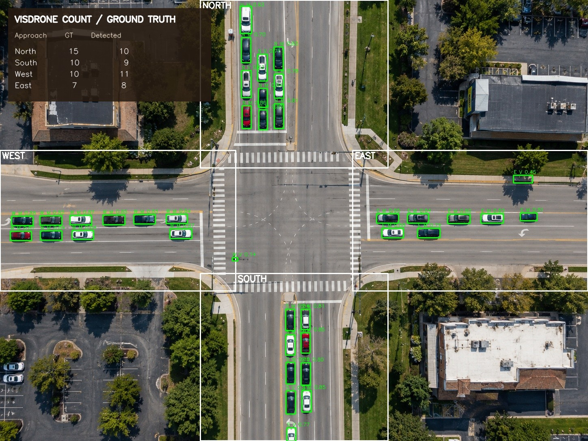

# Detector evaluation and ablation

## Dataset and protocol

Inference was rerun on the repository's 16 images (`computer-vision/data/test`) and directional count annotations (`ground_truth.json`). There are 643 annotated vehicles over 64 image–approach pairs. The dataset is small, has already been used for a prior evaluation, and may have informed threshold or model choices; treat this as a reproducibility and pipeline diagnostic, not an independent holdout or a generalization estimate. The annotations contain counts by approach, not bounding boxes, so object-level precision, recall, and mAP cannot be computed.

All models ran on CPU with Ultralytics 8.4.129 and PyTorch 2.7.1+cpu at `imgsz=1280`. Direct single-scale inference used confidence 0.03, with COCO vehicle classes `[2,3,5,7]` and VisDrone classes `[0,1,2,3]`. The production detector uses full-frame proposal confidence 0.01 followed by vehicle confidence filtering at 0.03. Crops use confidence 0.05, scales x2/x3, 60 px zone padding, and optional IoU duplicate suppression at 0.30. The production detector implementation was imported from `computer-vision/` without modifying that nested source repository.

Vehicle Count Accuracy is `max(0, 1 − Σ|prediction − actual| / Σactual)`. Directional MAE is summed absolute count error divided by 64 image–approach pairs. VCA is not precision, recall, or mAP.

## Results

| Inference variant | VCA (%) | Directional MAE | Predicted total | Sum absolute directional error |
|---|---:|---:|---:|---:|
| COCO YOLO11s, direct single-scale | 38.88 | 6.141 | 480 | 393 |
| VisDrone, direct single-scale | 85.38 | 1.469 | 699 | 94 |
| VisDrone, production full-frame path only | 86.16 | 1.391 | 676 | 89 |
| VisDrone, x2 crops + NMS | 85.38 | 1.469 | 683 | 94 |
| VisDrone, x3 crops + NMS | 85.38 | 1.469 | 683 | 94 |
| VisDrone, x2 and x3 crops + NMS (production) | 85.23 | 1.484 | 684 | 95 |
| VisDrone, x2 crops, no NMS | 0.00 | 12.219 | 1,425 | 782 |
| VisDrone, x3 crops, no NMS | 0.00 | 12.203 | 1,424 | 781 |
| VisDrone, x2 and x3 crops, no NMS | 0.00 | 23.547 | 2,150 | 1,507 |

The production result exactly reproduces `computer-vision/evaluation_results.json` on all four aggregate measures (643 actual, 684 predicted, error 95, VCA 85.23%, MAE 1.484375). This confirms reproducibility of the current checkpoint and implementation on these files. The COCO baseline is a different pretrained model and direct inference pipeline; this comparison holds image, resolution, inference library, and confidence threshold constant, but uses each model's respective vehicle class IDs.

The ablation shows that duplicate suppression is essential when combining full-frame and crop detections. Adding x2 or x3 crops individually did not improve aggregate count accuracy over the direct single-scale VisDrone run. Combining both crop scales with the production pipeline slightly worsened VCA relative to the full-frame-only production path (85.23% vs 86.16%). Because the direct single-scale implementation differs in confidence filtering and postprocessing from the production full-frame function, do not interpret their small numerical differences as a causal effect of weights or scale alone. Per-image outputs are preserved in the ignored machine-readable result.



*Example image 06: ground-truth / predicted counts north 15/10, south 10/9, west 10/11, east 7/8.*

## Checkpoint record and reproducibility

The VisDrone checkpoint SHA-256 is `1081e2ccd9a632079238033a65ecd71a4ed413b8ee7a68762b3df418bcf1de10`. Embedded checkpoint metadata reports Ultralytics 8.4.129, date 2026-08-27, four classes (`car`, `motorcycle`, `bus`, `truck`), 20 epochs, image size 960, batch 2, seed 0, and an initial checkpoint at `runs/visdrone_vehicles_continue_25/weights/best.pt`. The referenced dataset path and training run are absent from this workspace. Metadata is a claim embedded in the checkpoint, not independent provenance evidence; rights to redistribute the weights and training data have not been verified.

COCO YOLO11s SHA-256: `85a76fe86dd8afe384648546b56a7a78580c7cb7b404fc595f97969322d502d5`. Both checkpoint records claim AGPL-3.0 metadata; this evaluation does not independently establish licensing or redistribution rights.

Reproduce from repository root after installing the project dependencies plus `ultralytics==8.4.129`, CPU PyTorch, and OpenCV:

```bash
python scripts/evaluate_perception_models.py \
  --device cpu --threads 2 \
  --output outputs/perception_comparison.json
```

The script downloads `yolo11s.pt` when absent, caching it in the system temporary directory. It writes the complete per-image result only under `outputs/`, which is ignored by Git. The verified run used `/tmp/ai-traffic-lights-venv` and produced `outputs/perception_comparison_verified.json`.
