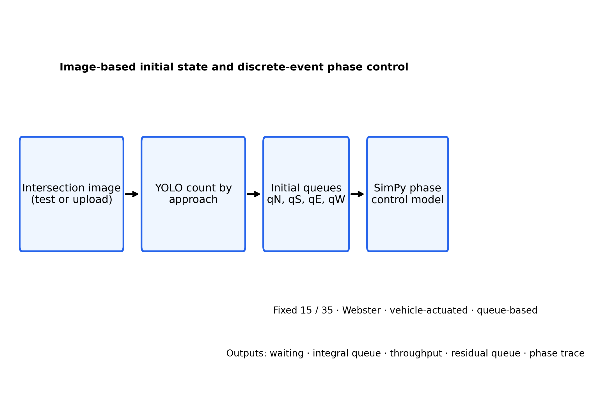
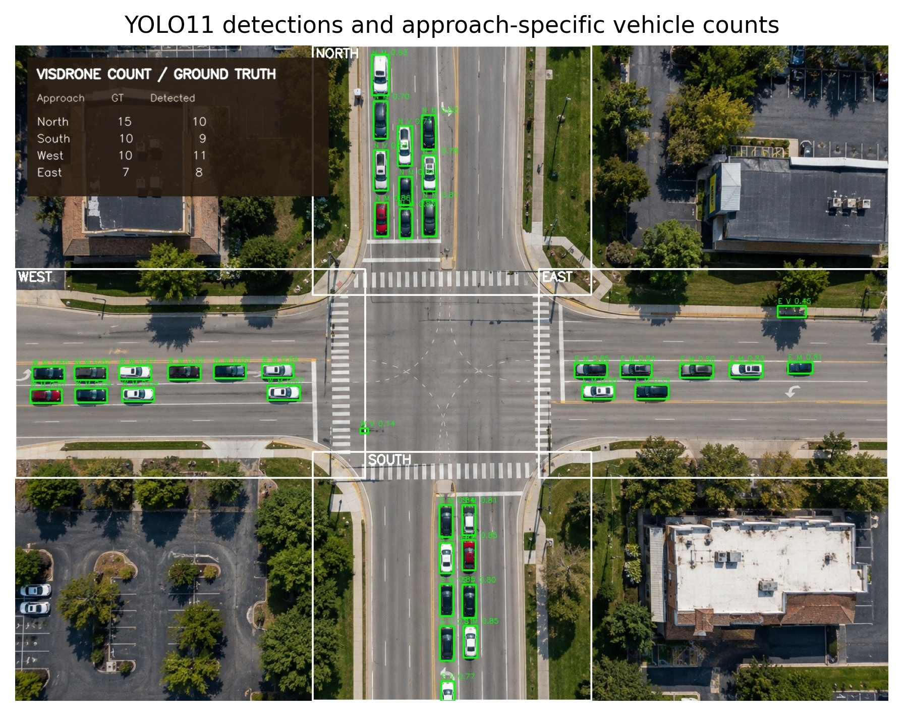
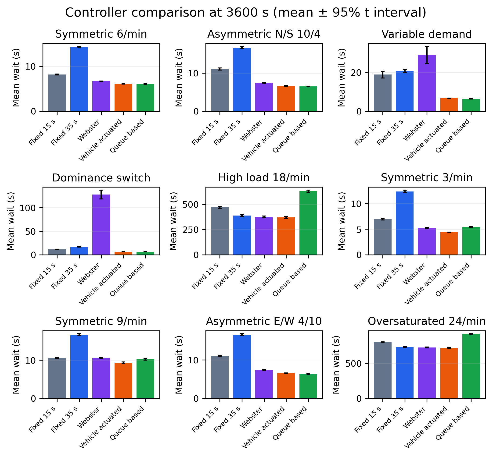
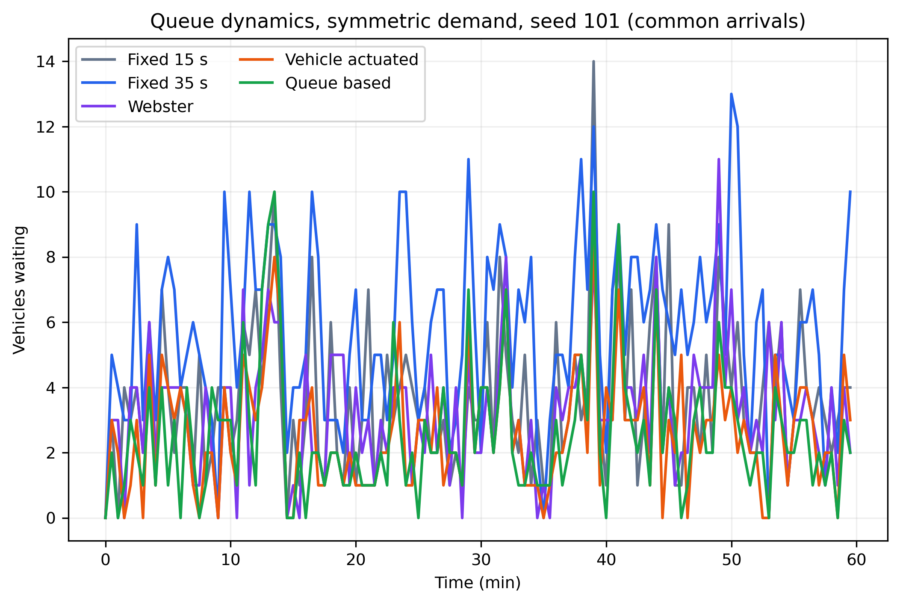
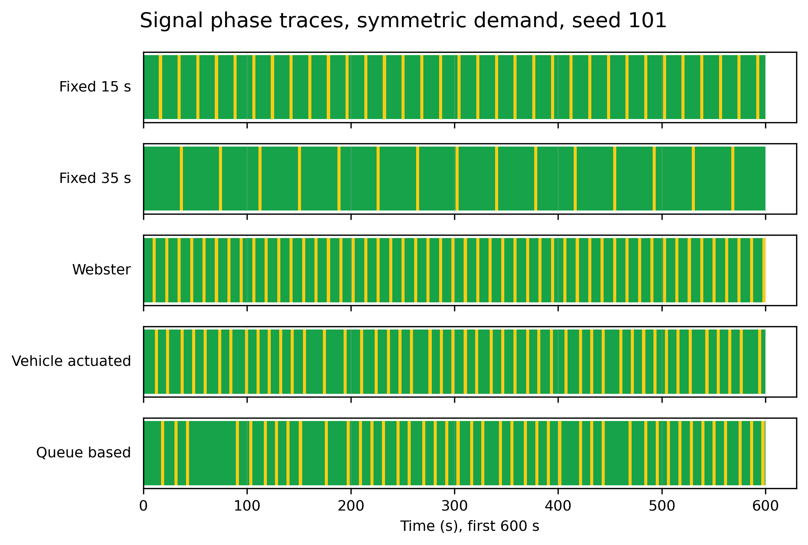
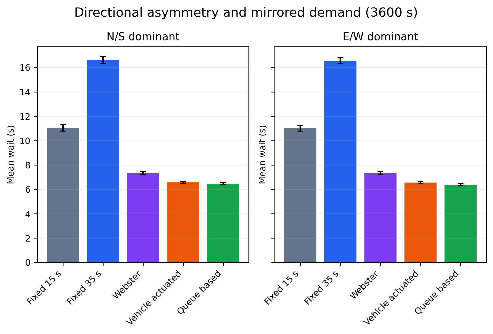
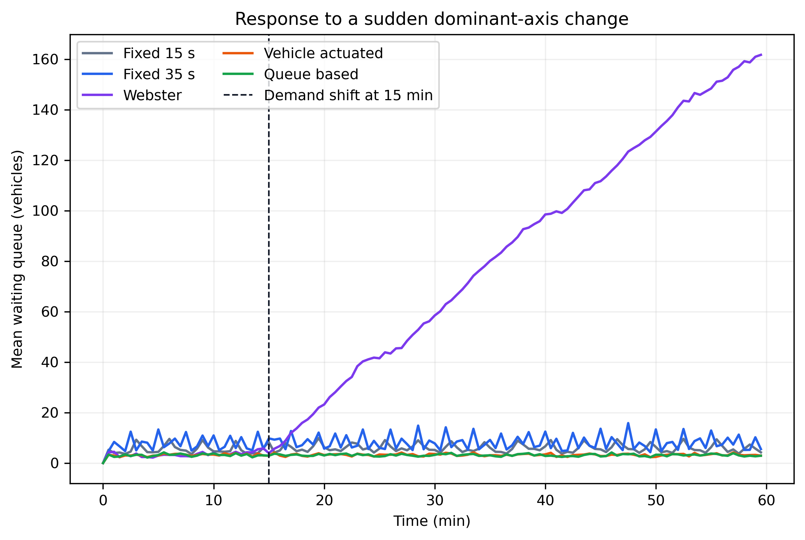
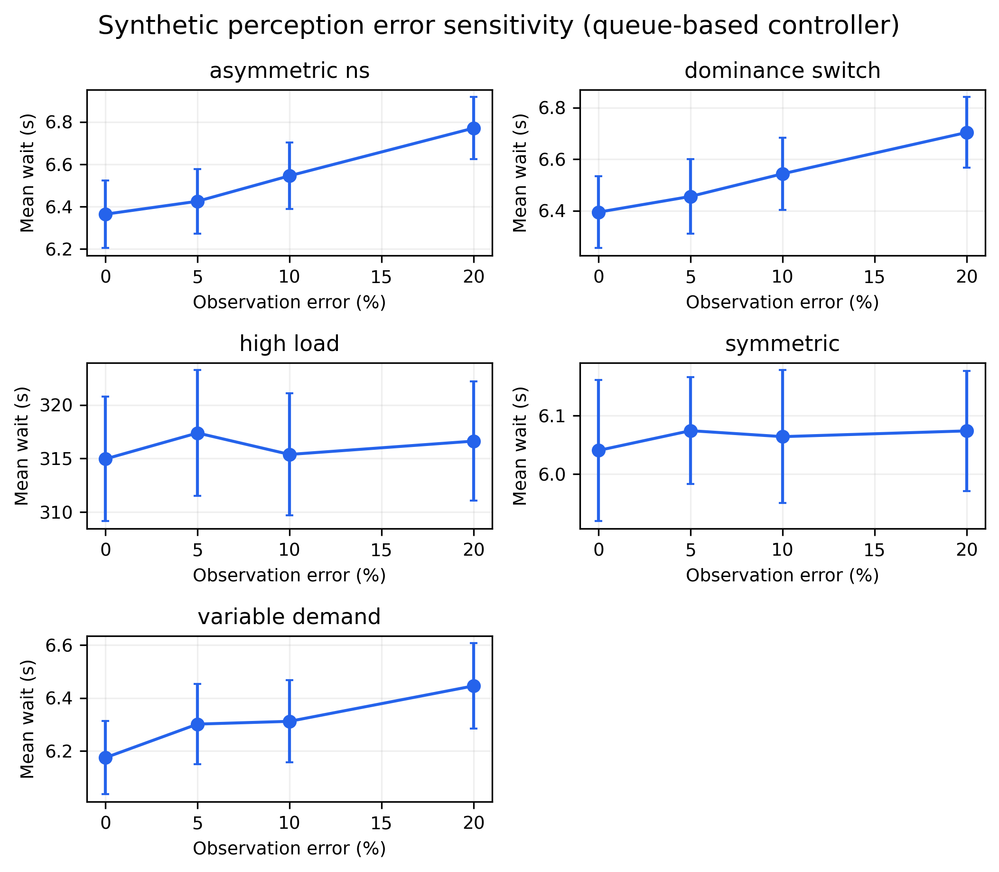
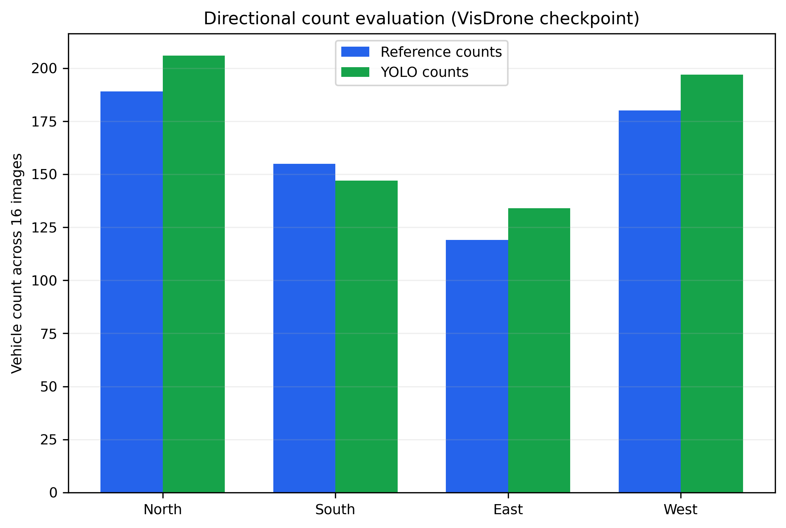
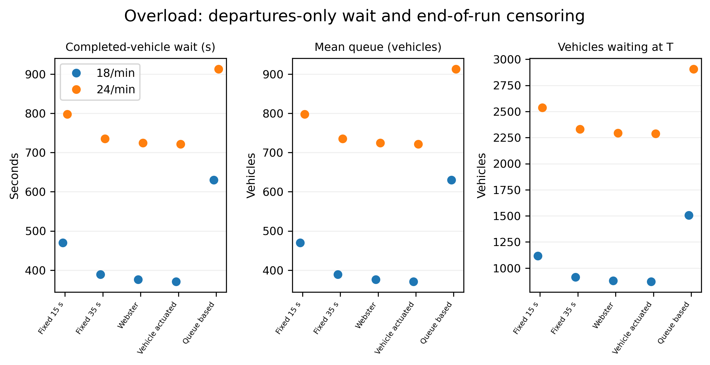

# Queue-Aware Traffic Signal Phase Control with Image-Based Initial State Estimation

**Darya A. Limarenko¹, Kseniya M. Stegantseva¹, Elena Yu. Silantyeva¹**
¹ Information Processing and Control Systems Department (IU5), Bauman Moscow State Technical University, Moscow, Russia
Contact: Darya A. Limarenko (dascha.limarenko@gmail.com); Kseniya M. Stegantseva (kseniyastegantseva@gmail.com); Elena Yu. Silantyeva (iu5elena@bk.ru)

The original 5-seed percentages are not carried forward because the implementation used for those values had phase, service-completion, and queue-accounting defects. The revised experiments use 30 seeds and paired arrival streams at two horizons. Detector provenance and the original reviewer report remain unavailable.

## Abstract

This study examines queue-aware phase selection at an isolated four-approach signalized intersection. A camera detector estimates an initial count for each approach, and a discrete-event model represents subsequent arrivals, service, and phase transitions. Thirty-seed paired experiments at 1800 s and 3600 s show that queue-based control lowers mean waiting in the symmetric, asymmetric, and demand-shift cases relative to fixed-time controls, but performs substantially worse in the 18-vehicle/minute-per-approach high-load case. Under high load, queues grow for all controllers; queue-based control leaves more vehicles waiting than the fixed-Webster and vehicle-actuated baselines. A corrected 1,200-run sensitivity experiment across five demand regimes shows small, demand-dependent increases in queue-based mean waiting under 0–20% synthetic observation errors; the high-load changes are not consistently monotonic. The revised model records waiting, in-service, and departed vehicles separately, inserts an exclusive yellow transition, and uses identical seeded arrival events across controller comparisons. The detector's 16-image evaluation reports Vehicle Count Accuracy of 85.23% and is reproducible on that same diagnostic set, but its training provenance and generalization remain unverified.

**Keywords:** traffic signal control, queue-based control, discrete-event simulation, vehicle detection, paired experiment

## Nomenclature

`v_i` is the arrival flow on approach `i`; `c_i` is its approximate service capacity; `ρ_i=v_i/c_i` is the demand-to-capacity ratio; `N_d` is the number of completed departures before horizon `T`; `Q(t)` is the total waiting queue; and `R(T)` is the number of vehicles still waiting at the horizon.

## I. Introduction

Fixed-cycle control allocates green time without responding to the current queue state. Reviews of road traffic control describe the broader range of fixed and traffic-responsive strategies [1]. Adaptive signal control has been studied through hierarchical real-time systems and reinforcement learning [3], [4], [6]; a recent systematic review maps the wider RL literature [5]. A queue-aware controller may reallocate service when demand changes, but its apparent advantage must be assessed under identical arrivals, explicit signal transition rules, and metrics that distinguish served vehicles from vehicles remaining at the end of observation. This revision tests the hypothesis that direct queue feedback changes mean waiting time relative to fixed-time baselines. It does not assume that the adaptive method wins.

The system is a research prototype for a single isolated intersection. Image detection supplies a four-approach initial state. SimPy then represents arrivals and service under a selected controller. The detector is not a continuous video tracker, and an image count is treated as a queue count only under the explicit assumption that vehicles visible in each approach zone are waiting vehicles.

## II. Model and temporal semantics

The state is `S(t) = [q_N(t), q_S(t), q_E(t), q_W(t), p(t)]`, where each `q` is the waiting queue and `p` is the active axis. North–south and east–west are mutually conflicting phases. A vehicle arriving at time `a_i` enters its approach queue. When green permits service, service starts at `s_i` and completes at `d_i = s_i + τ`, where `τ = 2 s` by default. Vehicles already in service may complete during yellow; a new service cannot start during yellow. The yellow interval is 3 s by default.

The simulation horizon is the half-open interval `[0,T)`. A completion at exactly `T` is right-censored and remains `in_service`; it is not counted as a departure. Initial vehicles exist at `t=0`, and their unknown pre-observation waiting is excluded. For every run the conservation identity is

**(1)** `N_initial + N_arrived = N_departed + N_waiting(T) + N_in_service(T)`.

Waiting time for a completed vehicle ends when service starts:

**(2)** `W_i = s_i - a_i`, for vehicles with `d_i < T`.

The reported mean is calculated only over completed vehicles. `observed_delay_seconds` separately accumulates queue delay to service start and the censored delay of vehicles still waiting at `T`; it is not mixed into the completed-vehicle mean. Average queue length is a time integral of waiting vehicles:

**(3)** `Q_mean = (1/T) ∫_0^T Σ_l q_l(t) dt`.

Controller decisions occur once per second. At an integer-time tie, the controller's phase decision is processed before a new service start. Arrivals are generated as independent Poisson processes with configured piecewise-constant rates. A SHA-256 digest of the generated event list is stored with each run so paired controller inputs can be audited.

## III. Controllers

`fixed_15` and `fixed_35` hold each green for 15 s and 35 s, respectively, followed by yellow. These baselines do not use queues for timing.

The fixed Webster baseline uses the classical Webster signal-timing method [2]. It estimates critical lane-group flow ratios as `y_NS = max(v_N,v_S)/s` and `y_EW = max(v_E,v_W)/s`, with saturation flow `s = 30 veh/min/lane` implied by the 2 s discharge headway. For `Y = y_NS + y_EW < 0.90`, it uses Webster's optimum cycle estimate

**(4)** `C_0 = (1.5 L + 5)/(1 - Y)`,

where `L` is the two-phase lost time per cycle, then allocates effective green `(C_0 - L)` in proportion to the two critical flow ratios. Greens are bounded by 8 s and 45 s. If `Y ≥ 0.90`, `Y = 0`, or the lost time makes the formula non-operational, the controller uses a documented equal split bounded to 8–45 s. This is a fixed split derived from configured mean rates, not future random arrivals.

`vehicle_actuated` honors an 8 s minimum and 45 s maximum. It extends the active phase while its observed queue remains nonempty, and may gap out after the observed active queue is empty for 3 s while the competing phase has a request. Because the model has no loop-detector passage times, this is an aggregate-queue gap proxy rather than detector-level actuated control.

`queue_based` switches after minimum green when the competing queue exceeds the current queue by more than one vehicle, or when 45 s maximum green is reached and a competing request exists. `queue_based_legacy` retains the previous pressure comparison and switching margin, separately named for reproducibility. Maximum green prevents a waiting competing direction from being postponed indefinitely.

## IV. Demand, capacity, and experimental design

The configured design includes symmetric demand, asymmetric north–south demand, a 900 s demand change, a sudden switch in dominant axis at 900 s, and a high-load case. With 2 s per vehicle, one approach can discharge 30 vehicles/min during green. Under a 35 s green and 3 s yellow for each of two phases, an equal split gives an approximate per-approach capacity `c ≈ 30 × 35/(2 × 35 + 2 × 3) = 13.82 veh/min`. Therefore the earlier 9 veh/min case has an approximate `v/c ≈ 0.65` and is not labelled oversaturated. The 18 veh/min case has approximate `v/c ≈ 1.30`; the final overload claim still requires persistent queue growth and end-of-run residual queues to confirm that control timing does not change the actual capacity ratio.

The full configurations specify 30 seeds and horizons of 1800 s and 3600 s. Every controller in a given scenario/seed receives the same generated arrival list. Parameter values are explicit in YAML; no test-run future arrival stream is used to tune a controller. The complete series was run for all five scenarios and six controller configurations. A separate perception sensitivity configuration holds physical arrivals and queues independent of sensing and applies reproducible count errors of 0%, 5%, 10%, and 20% only to controller observations.

For each scenario and horizon, the primary contrast is `queue_based − comparator` in mean waiting time, paired by seed. A 95% Student-t interval is reported for the mean paired difference. The two-sided exact sign test is used as a distribution-light paired test; Holm's step-down adjustment is applied to the five controller comparisons within each scenario/horizon family. This tests direction of paired differences, not their magnitude. The 3 and 9 veh/min symmetric levels, mirrored E/W asymmetry, and 24 veh/min clearly overloaded level were added in a separate addendum with seeds 301–330. The original 18 veh/min `high_load` results keep their original scenario name and values.

No warm-up is removed from these experiments. The estimand is the transient response to demand beginning at time zero from an initially empty intersection (or a stated image-derived initial queue), so deleting an initial interval would change the question. The 1800/3600 s runs are not interpreted as stationary replications. For overloaded cases, mean waiting among completed vehicles is a departures-only statistic: vehicles that remain in the system are right-censored and can make this mean look deceptively low. We therefore report queue-area delay and `R(T)` beside completed-vehicle wait; conclusions about overload use persistent growth in these measures, not mean wait alone.

Approximate capacity and the volume-to-capacity ratio are

**(5)** `c_i ≈ s g_i/C`,  `ρ_i = v_i/c_i`,

where `s=30 veh/min` is the model's saturation discharge rate and `g_i/C` is the green share allocated to the approach. System throughput and mean queue are

**(6)** `X = 3600 N_d/T` (veh/h),  `Q̄ = (1/T)∫₀ᵀQ(t)dt` (veh).

For controller `k`, the seed-level mean completed-vehicle wait is

**(7)** `W̄_k = (1/N_{d,k}) Σ_{j:d_j<T}(s_j-a_j)`.

The paired difference for common seed `r` and comparator `b` is

**(8)** `Δ_r = W̄_{queue,r} − W̄_{b,r}`,  `Δ̄ = (1/n)Σ_r Δ_r`.

The two-sided 95% interval for that mean paired difference is

**(9)** `Δ̄ ± t_{0.975,n−1} s_Δ/√n`.

When a baseline is absent, relative improvement is undefined and is reported as N/A. When a baseline exists, percentage change is

**(10)** `I = 100 (W̄_b − W̄_k)/W̄_b`.

## V. Perception and system integration

We reran inference on the repository's 16 annotated images (643 vehicles; 64 image–approach pairs). The existing VisDrone checkpoint reproduced its recorded full pipeline exactly: 684 predicted vehicles, summed absolute directional-count error 95, Vehicle Count Accuracy (VCA) 85.23%, and directional MAE 1.484. Direct single-scale VisDrone inference yielded VCA 85.38% and MAE 1.469; the production full-frame path alone yielded 86.16% and 1.391. A COCO-pretrained YOLO11s single-scale baseline yielded 38.88% and 6.141. These are aggregate count metrics, not object-level precision, recall, or mAP; bounding-box annotations are unavailable, so those detection metrics cannot be calculated. VCA is defined as `max(0, 1 − Σ_i,l |ŷ_i,l − y_i,l| / Σ_i,l y_i,l)`.

The direct single-scale call applies confidence 0.03 in Ultralytics inference; the production full-frame function first proposes boxes at 0.01 and then applies the 0.03 vehicle filter. Its result is therefore a pipeline comparison, not an isolated weight comparison. The existing 16-image set has already been used for evaluation and may have informed model or threshold choices; these measurements are diagnostic and do not constitute an independent test set. Training data and run artifacts are absent, so checkpoint lineage and data rights remain unverified. See `paper/perception_results.md` for the complete ablation and reproduction details.

The 85.23% score cannot be converted directly into a 14.77% independent per-vehicle error probability. The synthetic sensitivity experiment uses a different, explicit perturbation: for each true queued vehicle and decision time, a seeded draw either removes that count, duplicates it by one, or leaves it unchanged, with total perturbation probability equal to the requested rate and equal miss/duplicate probability. The corrected runner passed the YAML rate to the simulation. Across five demand regimes and 30 seeds, the paired 20%-versus-0% mean-wait change for queue-based control ranged from +0.02 to +1.66 s. A separate bootstrap resampled the observed signed per-direction count residuals from the 16 annotated images and added them to queues at each decision time; this resulted in 0.54–2.71 s higher queue-based mean wait in four demand regimes, while the high-load change was +0.43 s with a paired interval spanning zero. This is a small, reused dataset and an independent-over-time additive-error model; it is diagnostic, not a deployment estimate.

**Table II. Directional YOLO11 count totals on the 16-image diagnostic set.** These are image-level approach counts; no object-level box matches are available.

| Approach | Reference count | Predicted count | Absolute count error |
|---|---:|---:|---:|
| North | 189 | 206 | 17 |
| South | 155 | 147 | 8 |
| East | 119 | 134 | 15 |
| West | 180 | 197 | 17 |
| **Total** | **643** | **684** | **95** |

Summed-count VCA was 85.23% and directional MAE was 1.484 vehicles per image–approach pair. For comparison, the single-scale COCO YOLO11s detector reached 38.88% VCA and 6.141 MAE on the same set. The existing production full-frame path yielded 86.16% VCA and 1.391 MAE, while direct single-scale VisDrone inference yielded 85.38% and 1.469; because confidence thresholds and postprocessing differ, these are pipeline comparisons rather than a controlled checkpoint-only test.

The dashboard passes the four detector counts to the revised SimPy discrete-event model [9] as initial queues, starts with the axis having the larger initial queue, applies queue-based control, and converts its one-second trace to the existing animation format. This UI simulation has no further arrivals and uses an 8 s minimum and 30 s maximum green. The research experiments use the same physical model with generated arrivals and a 45 s controller maximum. The detector-to-SimPy code path is covered by simulation and dashboard contract tests, and live YOLO inference was rerun on the bundled annotated images. This validates inference against that dataset but does not establish performance on new intersections or independently validate the full interactive upload flow. YOLO11 is cited as software because its maintainers state that no formal YOLO11 paper has been published [7]. The VisDrone dataset has its own challenge paper [8].

The scale ablation found VCA 85.38% for x2 or x3 alone with NMS and 85.23% with both scales; without NMS, duplicate predictions raised totals to 1,424–2,150 and reduced VCA to zero. These ablations use the same previously evaluated image set and are descriptive, not independent validation.

## VI. Results and limitations

The original 1800 s and 3600 s series each contain 900 runs (five scenarios, 30 seeds, six controllers). Each addendum adds 720 runs per horizon (four additional scenarios, 30 new seeds, six controllers). Within every scenario/seed, controllers have matching arrival-stream hashes. Every run satisfies vehicle conservation, and queue time series have one sample per simulated second. Results are summarized in `paper/simulation_results.md`; machine-readable runs are in the revision branch under `outputs/`.

**Table I. 3600 s controller results across demand levels.** Each mean uses 30 seeds; residual queue is the average number still waiting at `T`. The best non-queue controller is selected separately per scenario; values are descriptive summaries, with paired intervals and corrected tests in the machine-readable reports.

| Demand scenario | Queue-based wait (s) | Best non-queue wait (s) | Queue-based mean queue (veh) | Throughput (veh/h) | Residual waiting (veh) |
|---|---:|---:|---:|---:|---:|
| Symmetric 6/min | 6.04 | 6.11 vehicle-actuated | 2.4 | 1433.6 | 2.4 |
| Asymmetric N/S 10/4 | 6.47 | 6.59 vehicle-actuated | 3.0 | 1669.7 | 3.6 |
| Variable demand | 6.41 | 6.61 vehicle-actuated | 3.0 | 1705.1 | 3.1 |
| Dominance switch | 6.48 | 6.64 vehicle-actuated | 3.0 | 1671.4 | 3.4 |
| High load 18/min | 630.22 | 371.36 vehicle-actuated | 755.0 | 2799.3 | 1505.1 |
| Symmetric 3/min | 5.41 | 4.35 vehicle-actuated | 1.1 | 712.3 | 1.1 |
| Symmetric 9/min | 10.28 | 9.35 vehicle-actuated | 6.1 | 2142.3 | 6.2 |
| Asymmetric E/W 4/10 | 6.38 | 6.55 vehicle-actuated | 3.0 | 1664.9 | 4.3 |
| True oversaturated 24/min | 913.02 | 721.53 vehicle-actuated | 1457.3 | 2821.8 | 2907.0 |

**Table III. Paired queue-based minus vehicle-actuated waiting-time differences at 3600 s.** Each comparison pairs the same 30 seeds. The interval is a 95% Student-t interval for the paired mean; p is from the two-sided exact sign test with Holm adjustment within the scenario family.

| Demand scenario | Pairs | Mean difference (s) | 95% CI (s) | Holm p |
|---|---:|---:|---:|---:|
| Symmetric 6/min | 30 | −0.07 | [−0.16, 0.02] | 0.856 |
| Asymmetric N/S 10/4 | 30 | −0.12 | [−0.20, −0.05] | 0.005 |
| Dominance switch | 30 | −0.17 | [−0.25, −0.08] | 0.001 |
| High load 18/min | 30 | +258.86 | [+255.11, +262.60] | <0.0001 |
| Symmetric 3/min | 30 | +1.06 | [+0.99, +1.13] | <0.0001 |
| Symmetric 9/min | 30 | +0.93 | [+0.77, +1.09] | <0.0001 |
| Asymmetric E/W 4/10 | 30 | −0.17 | [−0.26, −0.09] | 0.099 |
| True oversaturated 24/min | 30 | +191.49 | [+188.45, +194.53] | <0.0001 |

The queue-based policy has the lowest mean wait in some balanced and asymmetric scenarios, but not in all demand regimes. In the mirrored E/W case its point estimate is close to the vehicle-actuated result; at 3 and 9 veh/min, vehicle-actuated is lower. The fixed Webster controller also performs poorly following the demand shift because its split is set from the initial configuration and does not adapt to the new rate schedule.

At 1800 s, mean completed-vehicle wait for `queue_based` was 6.00 s in symmetric demand, 6.43 s in asymmetric demand, 6.17 s in variable demand, and 6.49 s after a dominant-axis switch. In symmetric demand it improved on fixed_35 by 8.13 s (95% CI [−8.37, −7.90]) and on Webster by 0.61 s ([−0.77, −0.46]); the comparison with vehicle-actuated was −0.11 s ([−0.24, 0.03]) and was not statistically significant after Holm adjustment. Similar results hold at 3600 s. In high_load, queue-based mean wait was 315.60 s at 1800 s and 630.22 s at 3600 s. It was worse than vehicle-actuated by 124.27 s ([121.22, 127.32]) and 258.86 s ([255.11, 262.60]), respectively, with adjusted `p < 0.001` at both horizons.

The high-load scenario is supported as overloaded in this model: the mean queue-based residual waiting count grew from 758 at 1800 s to 1505 at 3600 s, while mean arrivals grew from 2157 to 4306. Vehicle-actuated control also accumulated residual queues (448 and 872), but served more vehicles and had lower mean wait. These are simulation-specific outcomes under Poisson arrivals, a 2 s service time, and the configured phase logic; they are not field capacity measurements.

The corrected perception-sensitivity series has 1,200 runs: 30 seeds × five demand regimes × four error levels × two controllers. Arrival streams match across error levels within each regime/seed, while the stored `observation_error_rate` confirms that perturbation was applied. For queue-based control, mean wait at 0% and 20% error was 6.04 and 6.07 s (symmetric), 6.36 and 6.77 s (asymmetric N/S), 6.17 and 6.45 s (variable demand), 6.39 and 6.70 s (dominance switch), and 314.96 and 316.62 s (high load). Paired 95% intervals for the 20%-versus-0% changes were [−0.06, 0.13], [0.30, 0.52], [0.15, 0.40], [0.21, 0.41], and [−0.38, 3.71] s, respectively. This synthetic perturbation is not calibrated to detector errors; the high-load result is particularly variable.

The separate empirical-residual bootstrap used the 16 signed count errors observed per approach and resampled them at each one-second decision. Queue-based mean wait increased by 0.54 s (symmetric), 2.71 s (asymmetric), 2.03 s (variable), 2.16 s (dominant-axis switch), and 0.43 s (high load) relative to paired runs without this profile. The high-load 95% paired interval was [−1.29, 2.14] s. Because the same small image set supplies the residuals and the process ignores temporal error correlation, this experiment is diagnostic only; it is not independent detector validation.

Limitations include an isolated two-phase intersection, Poisson arrivals in the research scenarios, no turning movements, pedestrian calls, platoons, spillback, lane changes, or downstream blocking; a 1 s controller decision step; aggregate queue rather than detector headway for actuation; and a small image-count evaluation. The dashboard's image count assumes vehicles in each zone represent waiting vehicles. No video tracking or continuous camera control is modeled. Live checkpoint inference was rerun on the bundled test set, but this reused set is diagnostic only; unseen-scene performance and deployment-level visual behavior remain unvalidated. The original reviewer report was unavailable.

## VII. Conclusion

The revised model makes the comparison reproducible at the level of arrival events, phase timing, vehicle service, censoring, and per-run conservation. Across the paired scenarios, queue feedback can reduce delay where demand is within the modeled service capacity, but the queue-based policy can perform poorly when demand exceeds capacity. The added 24 veh/min case and the retained 18 veh/min case make overload claims visible through mean queue, cumulative delay, throughput, and end-of-horizon residuals. Completed-vehicle waiting time alone is not sufficient when a large share of the demand remains unserved.

The image detector supplies a plausible initial-state estimate on the available diagnostic images, and its count errors measurably affect the controller in sensitivity experiments. The evaluation set is small and previously reused; consequently, the result supports a reproducible prototype workflow, not general camera accuracy or field-ready signal control. Independent intersection imagery, documented training provenance, richer traffic dynamics, and field calibration are needed before deployment claims.

## Figures

Figure 1 presents the image-to-simulation architecture.

*Figure 1. Image detections initialize approach queues in the discrete-event signal model.*

Figure 2 gives the annotated detector example.

*Figure 2. VisDrone detections on test image 06. Ground-truth / predicted counts: north 15/10, south 10/9, west 10/11, east 7/8.*

Figure 3 compares controller mean waits with 95% intervals across demand regimes.

*Figure 3. Mean waiting and 95% t intervals for nine scenarios at 3600 s.*

Figure 4 shows same-seed queue trajectories under a shared arrival stream.

*Figure 4. Total waiting queue by controller for symmetric demand and seed 101.*

Figure 5 plots the phase trace for that same scenario and seed.

*Figure 5. Green and yellow intervals during the first 600 s of the matched seed.*

Figure 6 compares mirrored asymmetric demand.

*Figure 6. Mean wait under N/S and E/W dominant arrival rates, each based on 30 paired seeds.*

Figure 7 shows response to the scheduled demand switch at 900 s.

*Figure 7. Mean total queue over 30 paired runs; the dominant demand axis changes at 15 min.*

Figure 8 reports sensitivity to synthetic observation errors.

*Figure 8. Queue-based waiting time across synthetic error probabilities, shown separately by demand regime.*

Figure 9 compares predicted and reference counts per direction.

*Figure 9. Aggregated directional counts across the 16-image diagnostic set.*

Figure 10 pairs completed-vehicle delay with queue accumulation and end-of-horizon residuals.

*Figure 10. Mean completed-vehicle wait, time-average queue, and residual waiting vehicles for 18 and 24 veh/min per approach.*

Every figure is also available as 300-dpi PNG and vector SVG/PDF in `paper/figures/`.

## References

[1] M. Papageorgiou, C. Diakaki, V. Dinopoulou, A. Kotsialos, and Y. Wang, “Review of road traffic control strategies,” *Proceedings of the IEEE*, vol. 91, no. 12, pp. 2043–2067, 2003, doi: [10.1109/JPROC.2003.819610](https://doi.org/10.1109/JPROC.2003.819610).

[2] F. V. Webster, *Traffic Signal Settings*, Road Research Technical Paper No. 39. London, U.K.: Her Majesty’s Stationery Office, 1958.

[3] P. Mirchandani and L. Head, “A real-time traffic signal control system: Architecture, algorithms, and analysis,” *Transportation Research Part C: Emerging Technologies*, vol. 9, no. 6, pp. 415–432, 2001, doi: [10.1016/S0968-090X(00)00047-4](https://doi.org/10.1016/S0968-090X(00)00047-4).

[4] B. Abdulhai, R. Pringle, and G. J. Karakoulas, “Reinforcement learning for true adaptive traffic signal control,” *Journal of Transportation Engineering*, vol. 129, no. 3, pp. 278–285, 2003, doi: [10.1061/(ASCE)0733-947X(2003)129:3(278)](https://doi.org/10.1061/%28ASCE%290733-947X%282003%29129%3A3%28278%29).

[5] M. Noaeen et al., “Reinforcement learning in urban network traffic signal control: A systematic literature review,” *Expert Systems with Applications*, vol. 199, art. 116830, 2022, doi: [10.1016/j.eswa.2022.116830](https://doi.org/10.1016/j.eswa.2022.116830).

[6] H. Wei, G. Zheng, H. Yao, and Z. Li, “IntelliLight: A reinforcement learning approach for intelligent traffic light control,” in *Proceedings of the 24th ACM SIGKDD International Conference on Knowledge Discovery & Data Mining*, 2018, pp. 2496–2505, doi: [10.1145/3219819.3220096](https://doi.org/10.1145/3219819.3220096).

[7] G. Jocher and J. Qiu, *Ultralytics YOLO11*, version 11.0.0, 2024. [Online]. Available: [https://docs.ultralytics.com/models/yolo11/](https://docs.ultralytics.com/models/yolo11/).

[8] P. Zhu et al., “VisDrone-DET2018: The vision meets drone object detection in image challenge results,” in *Computer Vision – ECCV 2018 Workshops*, Lecture Notes in Computer Science, vol. 11133, pp. 437–468, 2019, doi: [10.1007/978-3-030-11021-5_27](https://doi.org/10.1007/978-3-030-11021-5_27).

[9] SimPy Developers, *SimPy*, version 4.1.2, 2026. [Online]. Available: [https://pypi.org/project/simpy/4.1.2/](https://pypi.org/project/simpy/4.1.2/). Documentation: [https://simpy.readthedocs.io/](https://simpy.readthedocs.io/).

The revised list retains sources tied to the methods and software used here. The remaining entries from the previous article were not carried forward where they were unrelated to the implemented model; the two 2025–2026 traffic papers in the old list do not describe this study’s method or data.
