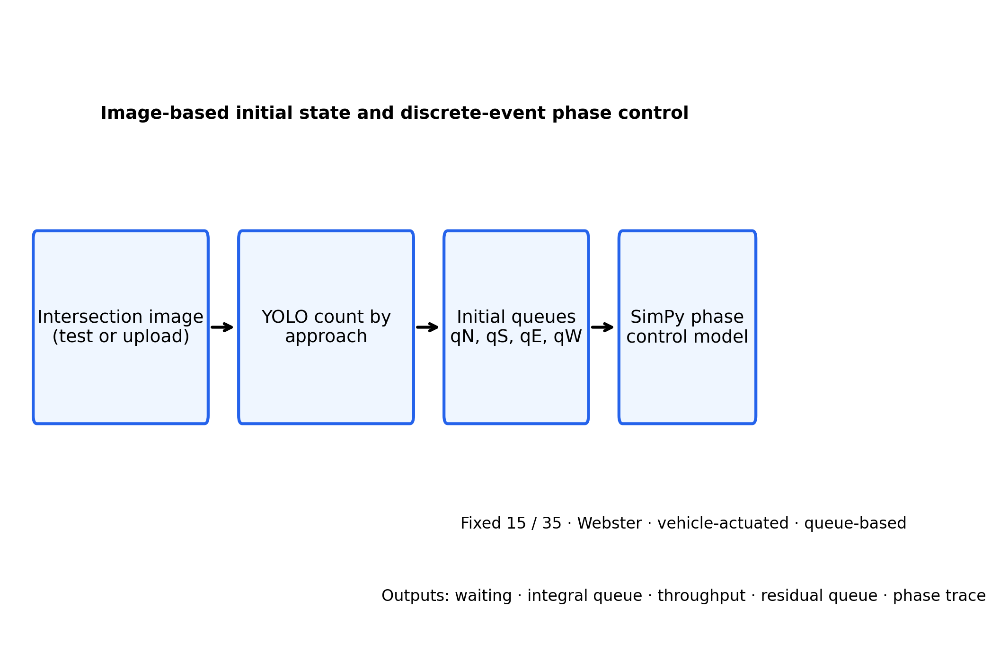
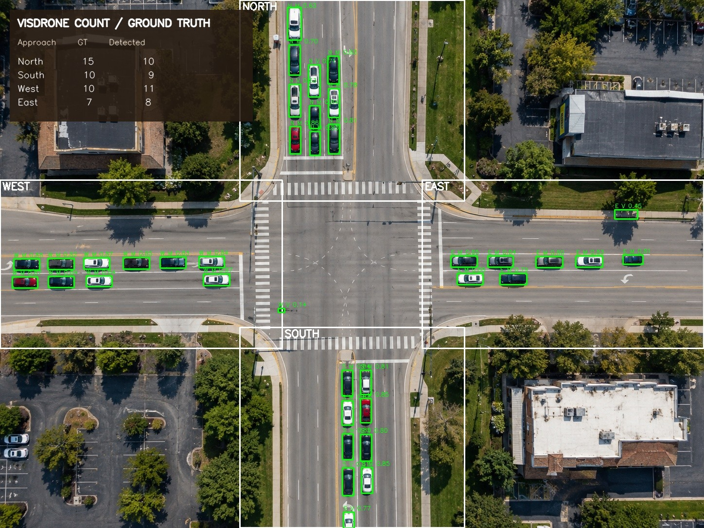
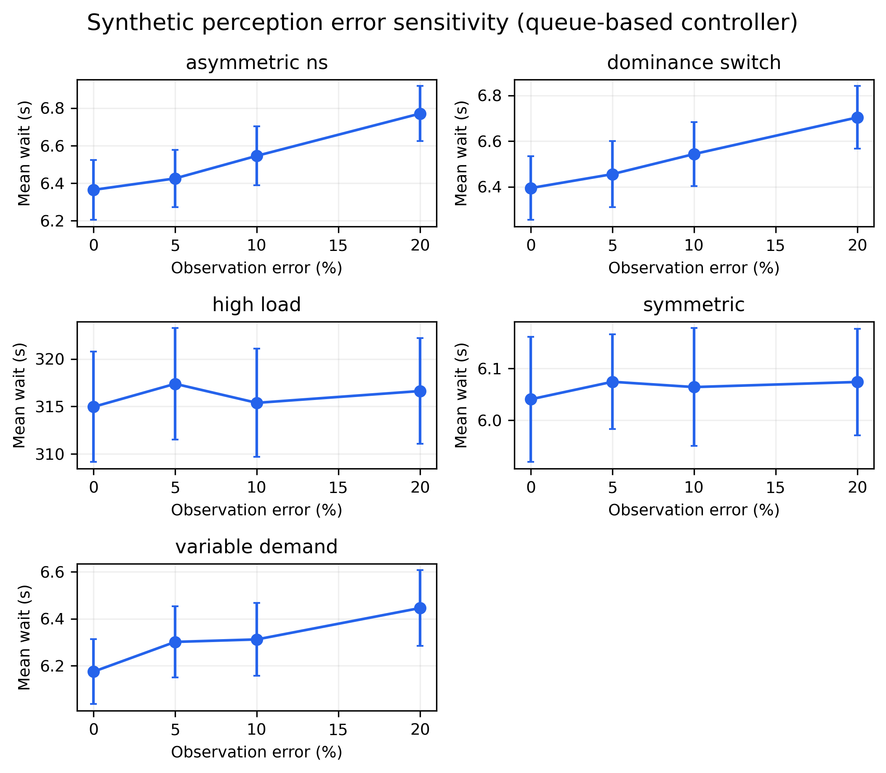
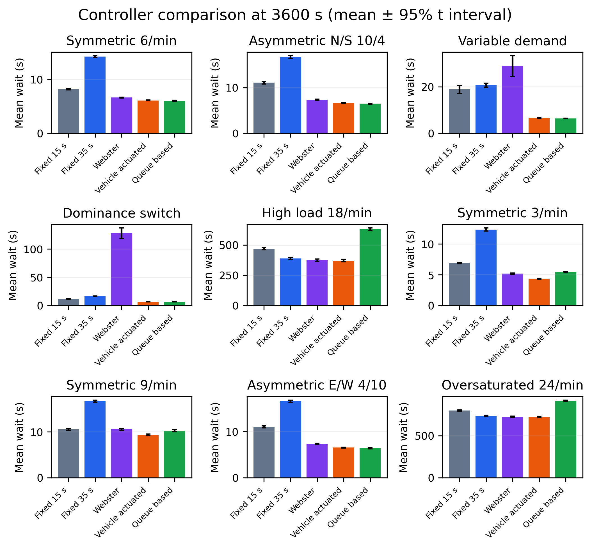
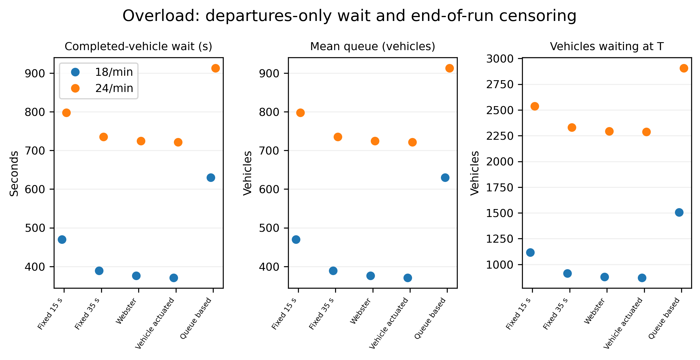

# Управление фазами светофора на основе очередей с инициализацией по изображению дороги

**Дарья А. Лимаренко¹, Ксения М. Стеганцева¹, Елена Ю. Силантьева¹**

¹ Кафедра информационных систем и управляющих процессов (ИУ5), Московский государственный технический университет имени Н. Э. Баумана, Москва, Россия

Для переписки: Дарья А. Лимаренко (dascha.limarenko@gmail.com); Ксения М. Стеганцева (kseniyastegantseva@gmail.com); Елена Ю. Силантьева (iu5elena@bk.ru)

## Аннотация

Подсчёт автомобилей на изображении может задать начальное состояние модели светофорного перекрёстка, однако эффект обратной связи по длинам очередей зависит от спроса, ограничений фаз и учёта машин, оставшихся в системе к концу прогона. Мы сравниваем детерминированное управление по очередям с фиксированными планами с зелёным 15 и 35 с, методом Вебстера и приближённым алгоритмом Vehicle-actuated на изолированном перекрёстке с четырьмя подходами. YOLO11s оценивает начальное число машин на подходах, а SimPy [9] моделирует последующие прибытия, обслуживание, жёлтый интервал и эволюцию очередей. Общие потоки прибытий Пуассона сравниваются для 30 seed при горизонтах 1800 и 3600 с в девяти сценариях спроса. Queue-based показывает наименьшее среднее ожидание завершивших обслуживание машин в нескольких сценариях умеренного спроса, но не при 3 и 9 авто/мин на подход. При 18 и 24 авто/мин он существенно уступает Vehicle-actuated и фиксированному Вебстеру: очереди больше, а машин, ожидающих к концу прогона, больше. На использованном ранее диагностическом наборе из 16 изображений точность подсчёта детектора составляет 85,23%; внесение ошибок в наблюдаемые количества умеренно увеличивает ожидание в большинстве проверенных режимов. Результаты подтверждают воспроизводимость процедуры сравнения, но не доказывают общего превосходства ИИ или готовности системы к эксплуатации на дорогах.

**Ключевые слова:** управление светофором; обратная связь по очереди; дискретно-событийное моделирование; обнаружение автомобилей; парный эксперимент

## 1. Введение

Фиксированный план светофора распределяет зелёное время без учёта текущих очередей. Метод Вебстера улучшает распределение фаз при заданном профиле спроса [2], тогда как адаптивные и обучаемые алгоритмы используют измерения или обратную связь по состоянию [1, 3–6]. Результат сравнения зависит от корректности базовых стратегий и единого учёта фаз и транспортных средств. В работе проверяется, снижает ли простое управление по очередям среднее ожидание относительно фиксированных и адаптивных алгоритмов, если каждому из них подаются одинаковые прибытия. Гипотеза имеет условный характер: обратная связь по текущим очередям может быть полезна при спросе в пределах пропускной способности, но не обязательно сохраняет эффективность при перегрузке. В отличие от сравнения только с нечувствительным фиксированным циклом, дизайн включает план Вебстера, рассчитанный по спросу, и приближение с управлением по очередям. Поэтому преимущество должно проявиться относительно как фиксированной, так и адаптивной базовой стратегии.

Вклад работы состоит в воспроизводимой оценке прототипа изолированного перекрёстка, начальное состояние которого формируется по изображению. YOLO11s выдаёт число машин в четырёх зонах подходов, а детерминированная эвристика выбирает одну из двух конфликтующих фаз. Это не обученная модель обучения с подкреплением. В экспериментах влияние алгоритмов разделяется благодаря общим потокам прибытия, ограничению длительности зелёного, явному жёлтому интервалу и раздельному учёту ожидающих, находящихся на обслуживании и выехавших машин.

## 2. Система и имитационная модель

На схеме рис. 1 показан сценарий, в котором одно изображение задаёт начальное состояние. Предполагается, что автомобили, обнаруженные в зоне подхода, стоят в очереди; видеосопровождение и предшествующее время ожидания не моделируются. Далее SimPy [9] формирует события прибытия и обслуживания. Фазы север–юг и восток–запад взаимно исключают друг друга. Для каждого подхода ведётся очередь; обслуживание начинается только на зелёный и заканчивается через 2 с. При смене фазы включается жёлтый на 3 с: уже начавшееся обслуживание может завершиться, но новое не начинается. Алгоритм пересчитывает фазу раз в секунду. В сценарии «изображение → симуляция» обнаруженные количества могут задать начальные очереди, однако полные парные серии спроса начинаются с пустых очередей; точность детектора и путь инициализации по изображению оцениваются отдельно. В sensitivity-серии изменяются наблюдения очереди контроллером при неизменных физических прибытиях. Такое разделение позволяет оценить алгоритмы управления отдельно от ошибок детектора. При совпадении целых временных отметок сначала обрабатывается решение о смене фазы, затем может начаться обслуживание. Такой порядок исключает запуск машины на фазе, которая уже переключилась. События прибытия генерируются согласно заданным кусочно-постоянным интенсивностям и повторно используются для всех алгоритмов одного парного seed.

*Рис. 1. Подсчёты на подходах по изображению задают очереди дискретно-событийной модели светофора.*

Моделирование выполняется на полуинтервале [0,T). Обслуживание, завершившееся точно в момент T, не учитывается как выезд. Начальные автомобили помещаются в систему в момент времени 0; их неизвестное ожидание до наблюдения не добавляется. Для каждого прогона проверяется баланс числа транспортных средств:

**(1)** N₀ + A(T) = D(T) + Q(T) + B(T), где N₀ — начальная очередь, A — последующие прибытия, D — число выехавших, Q — текущая очередь, B — автомобили на обслуживании.

Время ожидания машины, прибывшей в a_i и начавшей обслуживание в s_i, равно W_i=s_i−a_i. Среднее рассчитывается только по автомобилям, завершившим обслуживание до T:

**(2)** W̄=(1/N_d)Σ_{j:d_j<T}(s_j−a_j).

Средняя очередь и пропускная способность задаются формулами

**(3)** Q̄=(1/T)∫₀ᵀQ(t)dt;  X=3600D(T)/T авто/ч.

Ожидающие машины и незавершённое обслуживание сохраняются в состоянии системы на момент T. Поэтому при перегрузке среднее ожидание завершивших обслуживание интерпретируется вместе с пропускной способностью, площадью очереди и её остатком.

## 3. Алгоритмы и план эксперимента

Фиксированные базовые планы удерживают зелёный 15 или 35 с, после чего включается жёлтый. План Вебстера [2] оценивает критические коэффициенты потоков по заданным средним интенсивностям и распределяет эффективное зелёное время оптимального двухфазного цикла. Для осей север–юг и восток–запад используются y_NS=max(v_N,v_S)/s и y_EW=max(v_E,v_W)/s, где поток насыщения s=30 авто/мин. Формулы Вебстера для цикла и распределения зелёного имеют вид

**(4)** C₀=(1,5L+5)/(1−Y),  Y=y_NS+y_EW;  g_a=(C₀−L)y_a/Y,

где L — потерянное время двухфазного цикла, a обозначает одну из двух осей. Зелёное ограничено диапазоном 8–45 с; если оценка Вебстера неприменима, используется равное распределение внутри тех же границ. План задаётся по сценарию и не реагирует на последующее изменение спроса.

Алгоритм Vehicle-actuated продлевает зелёный, пока очередь активной фазы не пуста. Если конкурирующая фаза запрашивает обслуживание, текущая фаза может завершиться после трёх секунд пустой очереди; минимальное и максимальное зелёное равны 8 и 45 с. В модели нет времён проезда через детекторы, поэтому пустая очередь служит приближённым признаком разрыва потока. Эвристика Queue-based после минимальных 8 с переключает фазу, если очередь конкурирующего направления превышает текущую более чем на один автомобиль. При наличии запроса конкурирующего направления переключение также происходит по достижении максимума 45 с. Ни один из этих адаптивных алгоритмов не является обученной моделью ИИ.

Прибытия моделируются независимыми пуассоновскими потоками с постоянными внутри интервала интенсивностями. Для каждой пары сценарий/seed всем алгоритмам подаётся один и тот же список событий; это проверяется сохранённым SHA-256 хэшем. Пять исходных и четыре добавленных сценария рассчитаны для 30 seed и горизонтов 1800 и 3600 с: симметричный спрос 6 авто/мин на подход; асимметрия север–юг 10/4; переменный спрос; смена доминирующей оси в момент 900 с; высокая нагрузка 18 авто/мин; симметричный спрос 3 и 9 авто/мин; зеркальная асимметрия восток–запад 4/10; перегруженный режим 24 авто/мин. Исходный сценарий высокой нагрузки сохранён под прежним названием. Во всех прогонах для одного сценария применяются общие интенсивности по четырём подходам. При переменном спросе после 900 с поток меняется с 6 авто/мин на всех подходах на 3 авто/мин север–юг и 12 авто/мин восток–запад; в сценарии смены доминирующей оси интенсивности 10/4 меняются на 4/10. В сохранённых результатах есть и прежняя очередь-ориентированная версия, используемая для воспроизводимости реализации; в основную таблицу сравнения она не включена. Основное сравнение охватывает фиксированные планы 15 и 35 с, Вебстера, Vehicle-actuated и Queue-based.

Оценочная пропускная способность и отношение спроса к ней задаются формулами

**(5)** c_i≈s g_i/C;  ρ_i=v_i/c_i,

где g_i/C — доля зелёного для подхода. При 18 и 24 авто/мин рост очереди и остаток к концу прогона подтверждают перегрузку в рамках заданной модели, но не калибруют реальный перекрёсток.

При времени обслуживания 2 с интенсивность насыщенного потока составляет 30 авто/мин на зелёный. Для равного плана с зелёным 35 с и двумя жёлтыми интервалами по 3 с приблизительная пропускная способность одного подхода равна c ≈ 30×35/(2×35+2×3) = 13,82 авто/мин. Следовательно, 9 авто/мин ниже этой оценки (v/c≈0,65), а 18 авто/мин (≈1,30) и 24 авто/мин (≈1,74) выше неё. Это оценки внутри модели, а не измеренная пропускная способность реального перекрёстка.

В основной матрице 900 прогонов на каждый горизонт (пять сценариев × 30 seed × шесть конфигураций контроллера). Дополнение содержит по 720 прогонов на горизонт (четыре новых сценария × 30 новых seed × шесть конфигураций).

Основной контраст для seed r — разность среднего ожидания Δ_r=W̄_queue,r−W̄_baseline,r. Для среднего парного эффекта приводится 95%-й доверительный интервал Стьюдента: **(6)** Δ̄ ± t_{0.975,n−1}s_Δ/√n. Двусторонний точный парный sign test оценивает направление разностей; поправка Холма применяется к пяти сравнениям с базовыми алгоритмами внутри каждой семьи «сценарий/горизонт». Разогрев не отбрасывается: оценивается переходный режим из пустого состояния или заданной по изображению очереди, а не установившаяся работа.

## 4. Оценка распознавания

Производственный конвейер YOLO11s с весами VisDrone повторно проверен на 16 размеченных изображениях, содержащих 643 автомобиля и 64 пары «изображение–подход». Точность подсчёта автомобилей определяется как VCA = max(0, 1 − Σ|ŷ−y|/Σy); направленная MAE — абсолютная ошибка подсчёта на пару «изображение–подход». Инференс выполнялся на CPU с Ultralytics 8.4.129 и PyTorch 2.7.1 при размере входа 1280 пикселей. В прямых однокадровых запусках применялся порог уверенности 0,03. Производственный конвейер сначала формировал полнокадровые кандидаты при 0,01, затем фильтровал автомобили при 0,03 и объединял детекции на кропах с подавлением дубликатов. Весы VisDrone распознают классы car, motorcycle, bus и truck. Производственный конвейер обнаружил 684 автомобиля: VCA составила 85,23%, MAE — 1,484. Прямой однокадровый запуск VisDrone дал 85,38% и 1,469; только полнокадровый этап производственного конвейера — 86,16% и 1,391. Однокадровая модель YOLO11s с COCO-весами показала на тех же изображениях 38,88% и 6,141. Поскольку этапы обработки различаются, небольшие различия VisDrone-вариантов отражают весь конвейер, а не изолированный эффект весов модели. Добавление детекций на кропах масштаба x2 или x3 с подавлением дубликатов по отдельности дало VCA 85,38%; их совместное применение в производственном конвейере — 85,23%. Без подавления дубликатов комбинации кропов насчитали 1424–2150 машин, и VCA снизилась до нуля. Это показывает, что перекрывающиеся детекции могут исказить суммарный подсчёт, но не устанавливает независимо проверенный оптимальный порог.

*Табл. I. Направленный подсчёт на диагностическом наборе из 16 изображений.*
| Подход | Эталон | Предсказано | Абсолютная ошибка |
|---|---:|---:|---:|
| Север | 189 | 206 | 17 |
| Юг | 155 | 147 | 8 |
| Восток | 119 | 134 | 15 |
| Запад | 180 | 197 | 17 |
| Всего | 643 | 684 | 95 |

Это метрики подсчёта, а не precision, recall или mAP для отдельных объектов; разметки прямоугольниками нет. Небольшой набор уже использовался ранее и не является независимой тестовой выборкой. Происхождение обучающих данных, качество на новых сценах и права на распространение данных и модели не подтверждены. YOLO11 цитируется как программное обеспечение, поскольку разработчики не указывают формальную статью о YOLO11 [7]; набор VisDrone описан в работе [8].

В анализе чувствительности ошибки распознавания отделены от физических прибытий. На рис. 2 показан пример работы производственного детектора и зон подходов. В эксперименте сравниваются суммарные количества, а не точность сопоставления рамок с объектами.

*Рис. 2. Результаты VisDrone и зоны подходов на диагностическом изображении 06; эталонный/предсказанный подсчёт: С 15/10, Ю 10/9, В 7/8, З 10/11.*

При внесении синтетических ошибок 0–20% среднее ожидание Queue-based при 20% относительно 0% увеличилось на 0,03 с (95%-й парный интервал от −0,06 до 0,13) для симметричного спроса; на 0,41 с (0,30–0,52) при асимметрии; на 0,28 с (0,15–0,40) при переменном спросе; на 0,31 с (0,21–0,41) после смены доминирующей оси; на 1,66 с (от −0,38 до 3,71) при высокой нагрузке. Синтетические ошибки вносятся только в наблюдения контроллера, не изменяя физические прибытия и очереди: при каждом решении seeded-выбор определяет, будет ли машина пропущена, учтена повторно или распознана верно. Отдельный bootstrap знаковых направленных остатков на тех же изображениях повысил среднее ожидание на 0,54–2,71 с в четырёх режимах; при высокой нагрузке изменение составило 0,43 с (95%-й интервал от −1,29 до 2,14). Bootstrap независимо во времени выбирает остатки из 16 наблюдений. Оба вида возмущений иллюстрируют чувствительность, но не оценивают ожидаемые ошибки в эксплуатации.

На рис. 3 показана чувствительность к синтетическим ошибкам наблюдения по режимам спроса.

*Рис. 3. Среднее ожидание при разных вероятностях синтетической ошибки наблюдения по режимам спроса; показаны 95%-е интервалы.*

## 5. Результаты и обсуждение

В табл. II приведено среднее ожидание завершивших обслуживание автомобилей через 3600 с для пяти основных стратегий. Каждое значение усреднено по 30 парным seed. Queue-based показывает конкурентные результаты при асимметричном и меняющемся спросе, но не всегда является лучшим. При 3 и 9 авто/мин меньшее среднее даёт Vehicle-actuated. При 24 авто/мин наименьшее среднее у Vehicle-actuated (721,53 с), немного ниже Вебстера (724,44 с) и заметно ниже Queue-based (913,02 с). Значения округлены до сотых.

*Табл. II. Среднее ожидание завершивших обслуживание автомобилей, с, при T=3600 с (30 seed).*
| Сценарий спроса (авто/мин на подход) | Фикс. 15 | Фикс. 35 | Вебстер | Actuated | Queue-based |
|---|---:|---:|---:|---:|---:|
| Симметричный 6 | 8.16 | 14.22 | 6.64 | 6.11 | 6.04 |
| Асимметрия С/Ю 10/4 | 11.05 | 16.63 | 7.32 | 6.59 | 6.47 |
| Переменный | 18.88 | 20.73 | 28.89 | 6.61 | 6.41 |
| Смена доминирующей оси | 11.34 | 16.75 | 127.99 | 6.64 | 6.48 |
| Высокая нагрузка 18 | 469.82 | 389.21 | 375.96 | 371.36 | 630.22 |
| Симметричный 3 | 6.92 | 12.35 | 5.20 | 4.35 | 5.41 |
| Симметричный 9 | 10.58 | 16.70 | 10.58 | 9.35 | 10.28 |
| Асимметрия В/З 4/10 | 11.02 | 16.57 | 7.34 | 6.55 | 6.38 |
| Перегрузка 24 | 797.60 | 735.35 | 724.44 | 721.53 | 913.02 |

Парные разности Queue-based минус Vehicle-actuated показывают небольшое улучшение в части сценариев и заметное ухудшение в других (табл. III). Доверительный интервал средней парной разности вычисляется как

**(6)** Δ̄ ± t_{0.975,n−1}s_Δ/√n.

Sign test проверяет, какая стратегия чаще имеет меньшую задержку, но не оценивает размер эффекта. Поправка Холма контролирует семейную вероятность ошибки для пяти сравнений. При 6 авто/мин интервал включает ноль. Точечные оценки для асимметрии север–юг, переменного спроса, смены доминирующей оси и зеркальной асимметрии отрицательны, однако результат для восток–запад незначим после поправки. Эвристика уступает при 3 и 9 авто/мин, а при 18 авто/мин проигрывает 258,86 с. При 24 авто/мин разница составляет 191,49 с. Этот перегруженный режим отделён от высокой нагрузки 18 авто/мин: оба выше оценки пропускной способности при равном разделении, однако больший поток прибытий формирует более значительный остаток очереди. На горизонте 1800 с среднее Queue-based составляет 6,00 с при симметричном спросе 6 авто/мин и 315,60 с при 18 авто/мин. В последнем случае стратегия уступает Vehicle-actuated 124,27 с (95%-й интервал 121,22–127,32), что согласуется с результатом на горизонте 3600 с. Увеличение горизонта не меняет ранжирование стратегий при перегрузке. Парное сравнение исключает объяснение этих различий случайными потоками прибытий.

*Табл. III. Парные разности среднего ожидания Queue-based минус Vehicle-actuated при T=3600 с.*
| Сценарий | Пар | Δ ожидания (с) | 95%-й ДИ (с) | p Холма |
|---|---:|---:|---:|---:|
| Симметричный 6 | 30 | −0.07 | [−0.16, 0.02] | 0.856 |
| Асимметрия С/Ю 10/4 | 30 | −0.12 | [−0.20, −0.05] | 0.005 |
| Переменный | 30 | −0.21 | [−0.31, −0.10] | <0.0001 |
| Смена доминирующей оси | 30 | −0.17 | [−0.25, −0.08] | 0.001 |
| Высокая нагрузка 18 | 30 | +258.86 | [+255.11, +262.60] | <0.0001 |
| Симметричный 3 | 30 | +1.06 | [+0.99, +1.13] | <0.0001 |
| Симметричный 9 | 30 | +0.93 | [+0.77, +1.09] | <0.0001 |
| Асимметрия В/З 4/10 | 30 | −0.17 | [−0.26, −0.09] | 0.099 |
| Перегрузка 24 | 30 | +191.49 | [+188.45, +194.53] | <0.0001 |

На рис. 3 приведены средние значения и интервалы всех контроллеров для девяти сценариев спроса.

На рис. 4 сопоставлены средние ожидания и интервалы всех контроллеров в девяти сценариях.

*Рис. 4. Среднее ожидание по пяти алгоритмам в девяти сценариях; интервалы соответствуют 95%-м ДИ Стьюдента.*

На горизонте 1800 с среднее Queue-based составило 6,00 с при симметричном спросе, 6,43 с при асимметрии север–юг, 6,17 с при переменном спросе и 6,49 с после смены доминирующей оси. В симметричном сценарии оно было на 8,13 с ниже фиксированного плана 35 с, на 0,61 с ниже Вебстера и на 0,11 с ниже Vehicle-actuated; последний интервал включал ноль, различие не было значимым после поправки Холма. При 3600 с среднее Queue-based составляло 6,04 с для симметричных 6 авто/мин и 6,47–6,48 с в двух асимметричных и сценарии со сменой оси.

План Вебстера рассчитывается по средним интенсивностям сценария и не перестраивается вслед за изменением спроса в момент 900 с. Поэтому в сценарии смены доминирующей оси его среднее ожидание достигает 127,99 с. Queue-based и Vehicle-actuated реагируют на текущие очереди, и в этом сценарии их значения близки к 6,5 с. При низком и умеренном симметричном спросе Vehicle-actuated, напротив, обеспечивает меньшее среднее ожидание, то есть универсального преимущества эвристики Queue-based не наблюдается.

При перегрузке среднее ожидание завершивших обслуживание занижает нагрузку на систему: значительная часть прибывших остаётся в очереди и не входит в расчёт. Причина проигрыша конкретного контроллера отдельно не установлена. Возможное объяснение — частые переключения при непустых очередях увеличивают потери времени на жёлтый сигнал; для проверки этой гипотезы нужен отдельный анализ истории фаз. При 18 авто/мин средняя очередь Queue-based составляет 755 машин, а остаток ожидающих на момент T — 1505; для Vehicle-actuated показатели равны 445 и 872. При 24 авто/мин значения Queue-based составляют 1457 и 2907, а Vehicle-actuated — 1150 и 2289. Ниже и пропускная способность Queue-based: 2799 против 3432 авто/ч при 18 авто/мин и 2822 против 3440 авто/ч при 24 авто/мин.

На рис. 5 сопоставлены ожидание завершивших обслуживание, средняя и остаточная очереди для двух перегруженных режимов.

*Рис. 5. Ожидание завершивших обслуживание, средняя очередь и остаток ожидающих при 18 и 24 авто/мин на подход.*

## 6. Ограничения и выводы

Модель представляет изолированный двухфазный перекрёсток с пуассоновскими прибытиями, постоянным временем обслуживания 2 с и шагом решения в одну секунду. Не учитываются повороты, транспортные группы, пешеходные вызовы, перестроения, блокирование перекрёстка очередями и заторы ниже по потоку. Для Vehicle-actuated опустевшая очередь используется как приближённый признак разрыва потока. Подсчёт по изображению предполагает, что машины в зоне подхода стоят в очереди; предыдущее время ожидания неизвестно. Оценка детектора основана на 16 ранее использованных изображениях без разметки рамками и подтверждённой истории обучения. Эти эксперименты не устанавливают пропускную способность реального перекрёстка, точность на новых сценах или эксплуатационную готовность.

Управление по очередям может снижать ожидание в отдельных сценариях асимметрии и изменения спроса, однако Vehicle-actuated не уступает ему в ряде случаев ниже пропускной способности. При спросе 18 и 24 авто/мин стратегия Queue-based оставляет существенно больше машин в очереди и обслуживает меньше автомобилей в час. Научный вклад состоит в парном сравнении с аудитом событий, учитывающем эти потери, правое цензурирование и ошибки наблюдений. Для вывода о применении на дорогах необходимы независимая оценка изображений и более подробная модель транспортных потоков; результаты не подтверждают общее превосходство детерминированной эвристики как ИИ-контроллера.

## Литература

[1] M. Papageorgiou, C. Diakaki, V. Dinopoulou, A. Kotsialos, and Y. Wang, “Review of road traffic control strategies,” *Proceedings of the IEEE*, 91(12), 2043–2067, 2003. doi: 10.1109/JPROC.2003.819610.

[2] F. V. Webster, *Traffic Signal Settings*, Road Research Technical Paper No. 39. London: Her Majesty’s Stationery Office, 1958.

[3] P. Mirchandani and L. Head, “A real-time traffic signal control system: Architecture, algorithms, and analysis,” *Transportation Research Part C*, 9(6), 415–432, 2001. doi: 10.1016/S0968-090X(00)00047-4.

[4] B. Abdulhai, R. Pringle, and G. J. Karakoulas, “Reinforcement learning for true adaptive traffic signal control,” *Journal of Transportation Engineering*, 129(3), 278–285, 2003. doi: 10.1061/(ASCE)0733-947X(2003)129:3(278).

[5] M. Noaeen et al., “Reinforcement learning in urban network traffic signal control: A systematic literature review,” *Expert Systems with Applications*, 199, 116830, 2022. doi: 10.1016/j.eswa.2022.116830.

[6] H. Wei, G. Zheng, H. Yao, and Z. Li, “IntelliLight: A reinforcement learning approach for intelligent traffic light control,” in *Proc. 24th ACM SIGKDD*, 2018, pp. 2496–2505. doi: 10.1145/3219819.3220096.

[7] G. Jocher and J. Qiu, *Ultralytics YOLO11*, v. 11.0.0, 2024. https://docs.ultralytics.com/models/yolo11/.

[8] P. Zhu et al., “VisDrone-DET2018: The vision meets drone object detection in image challenge results,” in *Computer Vision – ECCV 2018 Workshops*, LNCS 11133, pp. 437–468, 2019. doi: 10.1007/978-3-030-11021-5_27.

[9] SimPy Developers, *SimPy*, v. 4.1.2, 2026. https://pypi.org/project/simpy/4.1.2/.
